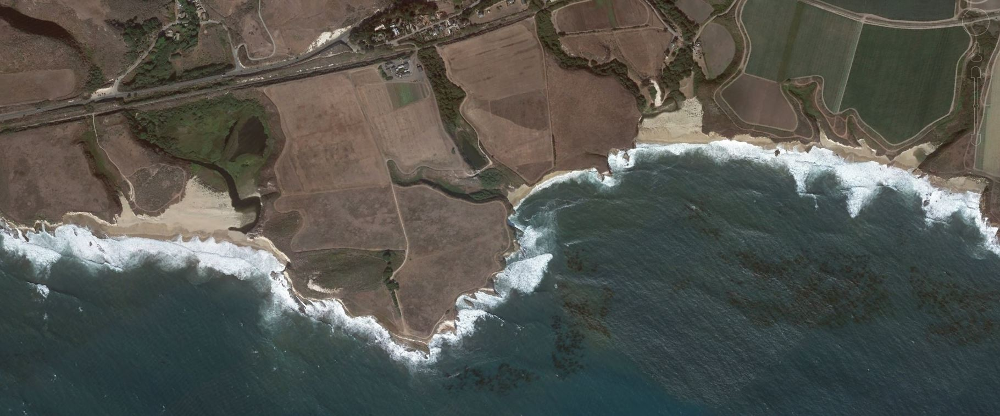
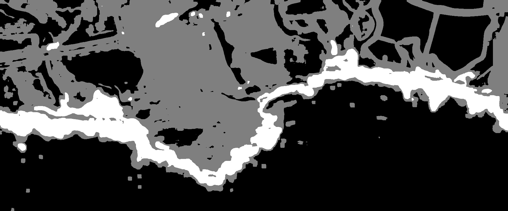

# Computer Vision and Image Processing

## Project Overview

This project was developed as a CS 136 Computer Vision term project at San José State University. It explores fundamental computer vision and image processing techniques using Python, OpenCV, and NumPy.

The project implements six image processing methods and applies them to four input images to examine image smoothing, edge detection, automatic thresholding, line detection, and texture-based segmentation.

The objective is to understand how different computer vision algorithms process visual information and how their outputs vary across images with different characteristics.

## Technologies Used

- **Programming Language:** Python
- **Computer Vision Library:** OpenCV
- **Numerical Computing:** NumPy
- **Techniques:** Gaussian filtering, Sobel edge detection, Canny edge detection, Otsu thresholding, Hough line detection, and texture-based segmentation
- **Development Environment:** Python scripts tested on macOS
- **Version Control:** Git and GitHub

## Implemented Techniques

### 1. Gaussian Filtering

Applies Gaussian smoothing to reduce image noise and soften fine details. Gaussian filtering can be used as a preprocessing step before more advanced image analysis.

**Implementation:** `Gaussian_Filter/gaussian_filter.py`

**Output Directory:** `Gaussian_Filter/Gaussian_Filter_Images/`

### 2. Sobel Edge Detection

Uses image intensity gradients to identify edges and structural boundaries. The Sobel operator estimates changes in pixel intensity along different directions.

**Implementation:** `Sobel_Edge_detection/Sobel_edge_detection.py`

**Output Directory:** `Sobel_Edge_detection/Sobel_Edge_Images/`

### 3. Canny Edge Detection

Uses the Canny edge detection algorithm to identify image boundaries. The implementation applies image-specific thresholds to account for differences in visual characteristics.

**Implementation:** `Canny_Edge_detection/Canny_edge_detection.py`

**Output Directory:** `Canny_Edge_detection/Canny_Edge_Images/`

### 4. Otsu Thresholding

Automatically determines an intensity threshold to separate darker and brighter image regions.

The implementation generates thresholded images and reports the selected threshold values.

**Implementation:** `Otsu_Thresholding/Otsu_thresholding.py`

**Output Directory:** `Otsu_Thresholding/Otsu_Thresholding_Images/`

### 5. Hough Transform

Combines Canny edge detection with the Hough line transform to identify line structures in images.

The implementation uses image-specific parameters and generates both edge maps and line-detection visualizations.

**Implementation:** `Hough_Transform/Hough_transform.py`

**Output Directory:** `Hough_Transform/Hough_Images/`

### 6. Texture-Based Segmentation

Uses grayscale texture features, including local mean and standard deviation, with K-means clustering to group image regions according to texture characteristics.

The implementation produces segmented images showing differences between visual regions.

**Implementation:** `Texture_segmentation/Texture_segmentation.py`

**Output Directory:** `Texture_segmentation/Texture_Segmentation_Images/`

## Project Structure

```text
Computer-Vision-Image-Processing/
│
├── Gaussian_Filter/
│   ├── gaussian_filter.py
│   └── Gaussian_Filter_Images/
│
├── Sobel_Edge_detection/
│   ├── Sobel_edge_detection.py
│   └── Sobel_Edge_Images/
│
├── Canny_Edge_detection/
│   ├── Canny_edge_detection.py
│   └── Canny_Edge_Images/
│
├── Otsu_Thresholding/
│   ├── Otsu_thresholding.py
│   └── Otsu_Thresholding_Images/
│
├── Hough_Transform/
│   ├── Hough_transform.py
│   └── Hough_Images/
│
├── Texture_segmentation/
│   ├── Texture_segmentation.py
│   └── Texture_Segmentation_Images/
│
├── input_images/
│   ├── coastline.JPG
│   ├── DW.jpg
│   ├── marine_brood.jpg
│   └── tahoe.JPG
│
├── Computer_Vision_Project_Report.docx
├── README.md
├── requirements.txt
└── .gitignore
```

Each technique folder contains its Python implementation and corresponding processed image results.

## Input Images

The project uses four input images:

- `coastline.JPG`
- `DW.jpg`
- `marine_brood.jpg`
- `tahoe.JPG`

These images contain different visual structures and textures, making them useful for demonstrating and comparing the implemented techniques.

## How to Run the Project

### 1. Clone the Repository

```bash
git clone https://github.com/AfrinHossai/Computer-Vision-Image-Processing.git
```

### 2. Navigate to the Project Directory

```bash
cd Computer-Vision-Image-Processing
```

### 3. Install Dependencies

Install the required Python packages:

```bash
python3 -m pip install -r requirements.txt
```

The project uses OpenCV for computer vision operations and NumPy for numerical computing.

**Note:** The dependency versions are not pinned. Installation has not yet been independently verified in a clean environment.

### 4. Input and Output Directories

All six Python scripts use paths relative to their file locations.

The input images are stored in the `input_images/` directory at the repository root.

Each technique saves its processed images in a corresponding output directory inside its technique folder.

The folder paths have been standardized and successfully tested on macOS.

### 5. Run the Image Processing Scripts

From the repository's root directory, use the following commands.

**Gaussian Filtering**

```bash
python3 Gaussian_Filter/gaussian_filter.py
```

**Sobel Edge Detection**

```bash
python3 Sobel_Edge_detection/Sobel_edge_detection.py
```

**Canny Edge Detection**

```bash
python3 Canny_Edge_detection/Canny_edge_detection.py
```

**Otsu Thresholding**

```bash
python3 Otsu_Thresholding/Otsu_thresholding.py
```

**Hough Transform**

```bash
python3 Hough_Transform/Hough_transform.py
```

**Texture-Based Segmentation**

```bash
python3 Texture_segmentation/Texture_segmentation.py
```

All six scripts were successfully executed on macOS using the four included input images.

The scripts save processed images in their respective output directories.

**Testing scope:** Successful local execution confirms that the scripts run on the tested machine. Clean-environment reproducibility and quantitative output accuracy have not yet been independently verified.

## Project Results

The repository contains saved processed images for all six computer vision techniques.

The results illustrate the effects of:

- Gaussian smoothing
- Gradient-based edge detection
- Canny edge detection
- Automatic thresholding
- Hough line detection
- Texture-based image segmentation

### Texture Segmentation Example

The following example compares an original coastline image with its texture-based segmentation result.

| Original Image | Texture Segmentation Result |
|---|---|
|  |  |

The segmentation highlights broad visual differences between ocean, land, and coastal foam.

The grayscale output reveals several distinct regions and preserves much of the coastline boundary. However, some fine details are lost, and certain regions remain fragmented.

This visualization demonstrates the implemented segmentation process but does not establish quantitative segmentation accuracy.

### Otsu Thresholding Results

The implementation produced the following threshold values for the four images:

| Image | Otsu Threshold |
|---|---:|
| coastline.JPG | 127 |
| tahoe.JPG | 106 |
| DW.jpg | 114 |
| marine_brood.jpg | 121 |

These values were obtained during local execution of the Otsu thresholding script.

### Hough Line Detection Results

The Hough line detection script reported the following numbers of detected lines:

| Image | Lines Detected |
|---|---:|
| coastline.JPG | 32 |
| tahoe.JPG | 16 |
| DW.jpg | 8 |
| marine_brood.jpg | 112 |

The results depend on the selected Canny and Hough parameters.

The reported counts represent detected line structures, not independently verified ground-truth measurements.

## Testing and Verification

All six implementations were executed successfully using the reorganized repository structure on macOS.

| Technique | Local Execution Status |
|---|---|
| Gaussian Filtering | Passed |
| Sobel Edge Detection | Passed |
| Canny Edge Detection | Passed |
| Otsu Thresholding | Passed |
| Hough Transform | Passed |
| Texture-Based Segmentation | Passed |

Each script completed and reported saving its processed images.

The repository was also checked for file organization and version-control consistency. The local Git working tree was verified as clean and synchronized with the remote repository after testing.

These checks establish basic execution functionality, rather than comprehensive algorithm correctness or cross-platform compatibility.

## Project Report

The accompanying project report provides additional background, methodology, implementation details, and discussion of the image processing results.

**[View Project Report](Computer_Vision_Project_Report.docx)**

## Limitations

- Different images may require different processing parameters.
- Edge detection can be sensitive to image noise and texture.
- Thresholding performance depends on image intensity distributions.
- Hough line detection may identify unwanted lines in highly textured images.
- Texture segmentation results depend on feature selection and clustering parameters.
- The project has not been quantitatively evaluated against labeled ground-truth datasets.
- Installation and execution have not been verified across multiple operating systems or clean Python environments.

## Future Improvements

- Add command-line arguments for input images and processing parameters.
- Introduce automated tests for key image processing operations.
- Evaluate applicable methods using quantitative metrics and labeled reference data.
- Pin and document dependency versions for reproducible installations.
- Expand testing to additional image datasets.
- Add more visual before-and-after comparisons across all six techniques.
- Investigate the sensitivity of results to parameter selection.
- Improve documentation of algorithm behavior and experimental observations.

## Author

**Afrin Hossain**

CS 136 — Computer Vision Term Project

San José State University

**GitHub:** [AfrinHossai](https://github.com/AfrinHossai)
